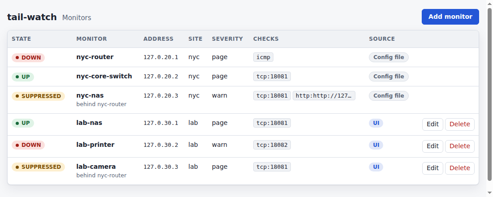
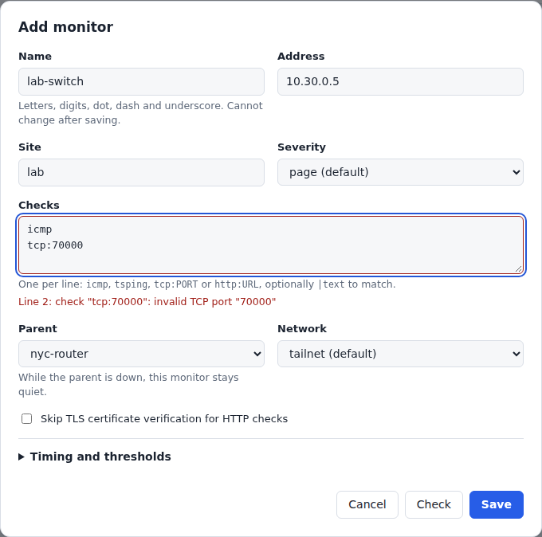
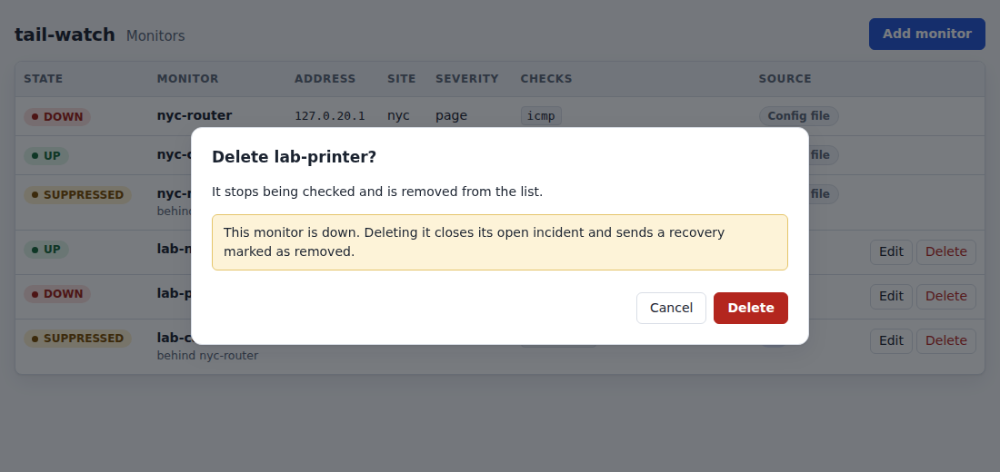

# tail-watch

tail-watch is a reachability collector for a tailnet. It runs beside a
kernel-mode `tailscaled`, probes the targets in a YAML file, and serves
a status page, Prometheus metrics, and a health check.

It answers a different question from the online/offline webhook: not
whether control thinks a node is connected, but whether traffic to that
node or to a subnet behind it actually gets through.

## Requirements

- A host running `tailscaled` in kernel mode. Userspace networking cannot
  carry ICMP to LAN addresses, so this build refuses it at startup.
- Tag the host `tag:monitor`. tail-watch logs a warning when that tag is
  missing, because ACL grants are usually written for the tag.
- The process must be able to open the LocalAPI socket. On Linux that is
  `/var/run/tailscale/tailscaled.sock` unless you pass `--socket`.

ICMP needs either unprivileged ping (`net.ipv4.ping_group_range`) or
`CAP_NET_RAW`. If neither is available, ICMP checks fail with that
guidance and TCP, HTTP, and tsping checks still run.

## Remote subnets and local LANs

`network` selects the path a target is supposed to take:

- `tailnet` (the default) means IP checks should use Tailscale. On Linux,
  a target whose address is a literal non-Tailscale IP is treated as a
  remote subnet. Startup fails until the host accepts subnet routes:

  ```bash
  tailscale set --accept-routes
  ```

  An advertised route is not an installed route. After accepting routes,
  check the route the host will actually use:

  ```bash
  ip route get 10.20.0.1
  ```

  The answer should go out the Tailscale interface (`tailscale0`), not a
  local gateway. Repeat that for each remote subnet you monitor.

- `local` means the host's ordinary route, including a LAN the collector
  is plugged into at a site. These checks keep working when that site's
  Tailscale router is down. They cannot use `tsping`. Put a `network:
  local` device in its own target; do not point an HTTP check at a
  different host than the target's `addr`.

`examples/tail-watch.yaml` has both kinds of target. `nyc-core-switch` and
`nyc-nas` are remote subnet devices behind `nyc-subnet-router`.
`lab-printer` is on the collector's own LAN.

## Build and run

```bash
mise install
mise run build
./bin/tail-watch --config examples/tail-watch.yaml
```

Config path order is `--config`, then `TAIL_WATCH_CONFIG`, then
`/etc/tail-watch/tail-watch.yaml`.

Validate a file without contacting tailscaled:

```bash
./bin/tail-watch check-config --config examples/tail-watch.yaml
```

Run every check once, print a line each, and exit non-zero on failure:

```bash
./bin/tail-watch --once --config examples/tail-watch.yaml
```

`--version` prints the build version. `--log-level` (or `TAIL_WATCH_LOG_LEVEL`)
is `debug`, `info`, `warn`, or `error`. Logs are JSON on stderr. Debug
logs include every check result.

| Flag | Env | Default |
| --- | --- | --- |
| `--config` | `TAIL_WATCH_CONFIG` | `/etc/tail-watch/tail-watch.yaml` |
| `--listen` | | `127.0.0.1:9109` or `collector.listen` |
| `--socket` | | platform LocalAPI socket |
| `--log-level` | `TAIL_WATCH_LOG_LEVEL` | `info` |
| `--once` | | run one pass and exit |
| `--version` | | print the version and exit |

HTTP endpoints on the listen address:

- `/` prober status page
- `/metrics` Prometheus text, `tailwatch_` series labeled `target`, `check`,
  `site`, and `class`. The prefix has no hyphen because Prometheus metric
  names cannot contain one.
- `/healthz` returns `200` and `ok`

SIGINT and SIGTERM stop new work, cancel running checks, and exit 0.

## Docker

The image listens as user `tail-watch` (uid 65532) and does not embed a
Tailscale node. Use host networking so checks share the host routes, and
mount the LocalAPI socket. That socket has to be readable by uid 65532,
or pass a `--user` / `--group-add` that can read it.

```bash
docker build -t tail-watch .
docker run --rm --network host \
  -v /var/run/tailscale/tailscaled.sock:/var/run/tailscale/tailscaled.sock \
  -v /etc/tail-watch/tail-watch.yaml:/etc/tail-watch/tail-watch.yaml:ro \
  tail-watch
```

### Docker Compose without a dedicated host

`examples/compose.yaml` runs a kernel-mode `tailscaled` container and puts
tail-watch in its network namespace, so checks follow that node's `tailscale0`
routes, including accepted subnet routes. Mint an auth key tagged
`tag:monitor`:

```bash
TS_AUTHKEY=tskey-auth-... docker compose -f examples/compose.yaml up -d
```

tail-watch starts once the node reports healthy. It reads
`examples/tail-watch.yaml` unless `TAIL_WATCH_CONFIG_FILE` names another file. The
`tailscale` service sets `net.ipv4.ping_group_range`, so the non-root tail-watch
image can send ICMP without `CAP_NET_RAW`. `network: local` targets reach
only what the container's Docker network can reach.

`collector.state_dir` holds notification state and, with the UI on, the monitors
created there. Do not put secrets in the config file.

## ACLs

The collector sees only what policy allows. A missing grant shows up as
`no peer handles <addr>; check grants to tag:monitor`.

```jsonc
{
  "tagOwners": { "tag:monitor": ["autogroup:admin"] },
  "grants": [
    {
      "src": ["tag:monitor"],
      "dst": ["tag:router", "tag:server"],
      "ip": ["*"]
    },
    {
      "src": ["tag:monitor"],
      "dst": ["10.20.0.0/16"],
      "ip": ["icmp:*", "tcp:22", "tcp:445", "tcp:443", "tcp:5001"]
    }
  ]
}
```

## Checks

| Check | Passes when |
| --- | --- |
| `icmp` | one echo reply arrives before the timeout |
| `tcp:<port>` | a TCP handshake completes; the socket is closed without sending |
| `http:<url>` | status is 2xx or 3xx; optional `\|text` must appear in the first 1 MiB |
| `tsping` | tailscaled reports a disco pong for the target address |

`http` does not follow redirects. `insecure_tls: true` on a target skips
certificate verification for devices that present a private certificate.
`tls` checks are rejected until phase 2.

An explicit `parent` must name another target whose only check is `icmp`
or `tsping`. Parent cycles are rejected. That parent is for suppression
only. It does not change which tailnet node handles the address.

## Failure layers

A passing check has no layer. A failing check is labeled with one layer:

| Layer | Meaning |
| --- | --- |
| `unrouted` | no peer owns or routes the address |
| `control` | the handling node is known offline |
| `tunnel` | the handling node is up, but disco fails |
| `service` | the device answered, or the target is a Tailscale node |
| `lan` | disco works and the device does not answer |

`network: local` targets use only `service` and `lan`. They do not consult
tailnet presence or disco.

## Alert state

Each target is `UNKNOWN`, `UP`, `DOWN`, or `SUPPRESSED`. It leaves `UNKNOWN`
for `UP` after one success on every check, and that move is silent. Any check
that fails `fail_threshold` times in a row moves the target to `DOWN`. It
returns to `UP` after `recover_threshold` consecutive successes on every check
that failed, while its other checks are still passing. The defaults are 3
failures and 2 successes.

More than `flap_limit` state changes inside `flap_window` (defaults 4 and 15m) mark the
target flapping. tail-watch emits one flapping notice, then stays quiet until
the state has been stable for another `flap_window`. While that mark is set,
`tailwatch_target_state` is 4.

A reachability parent (`icmp` or `tsping` only) that is `DOWN` or
`SUPPRESSED` moves its `UNKNOWN` and `UP` descendants to `SUPPRESSED` and
names them on its transition. A descendant that is already `DOWN` keeps its
own incident. A `control` or `tunnel` failure waits for the parent's detection
window (`interval × fail_threshold + timeout`) before it can page, so a dead
router produces one alert instead of one per device. `unrouted`, `lan`, and
`service` failures page immediately. When the parent recovers, or a topology
change leaves no down ancestor, tail-watch rechecks each released target. The
target then goes `UP` silently, or `DOWN` if the fresh checks keep failing.
If flap damping left an earlier `DOWN` unresolved, suppression preserves that
incident. The child sends its recovery after release when flap damping permits,
keeping the original outage start time; continued failures do not open a second
incident.

With more than one collector, quorum stays in Alertmanager until collectors
share state:

```yaml
- alert: TargetDownQuorum
  expr: count by (target) (tailwatch_target_state == 2) >= 2
  for: 1m
```

That rule pages only when two collectors agree the target is down.

For a remote LAN target, tail-watch learns the handling node with one disco
ping at startup, every 10 minutes, and when primary routes change. A failed
ping keeps the previous node unless the primary route changed, in which case
the route is used. An explicit `parent` still wins for suppression.

The learned parent is a configured target only when that target's address is
the handling node and its only check is `tsping`. A service check on the same
node does not suppress the LAN devices behind it. Otherwise tail-watch adds
an implicit `tsping` target named for the node's short MagicDNS name, adding
the stable node ID and then a number if that name is taken. An idle implicit
target that is still down stays until it recovers. While a target has no
handling node, tail-watch logs this once, and again only if the grant returns
and is then lost:

```text
target lab-pdu: no peer handles 10.99.0.5; check grants to tag:monitor
```

Prometheus series use the `tailwatch_` prefix:

| Metric | Kind |
| --- | --- |
| `tailwatch_failure_layer_total{target,layer}` | counter, one increment per failure |
| `tailwatch_path{target,kind}` | gauge, `direct`, `derp`, and `peer_relay` |
| `tailwatch_target_parent{target,parent}` | gauge, 1 for the current parent |
| `tailwatch_target_state{target}` | gauge, 0 unknown through 4 flapping |

## Monitor UI

Off by default, tail-watch reads its monitors from the YAML file at startup and
never changes them. With the UI on, it also serves a page at `/ui/` and a JSON API
under `/api/v1/` for adding, editing, and deleting monitors while it runs, with no
restart and no lost grace timers. Monitors from the YAML file appear in the list as
read-only; only monitors created in the UI can be changed there.

Turn it on with `--ui` or `collector.ui: true`. The flag wins, so `--ui=false` turns
off a config that enables it. The UI needs `collector.state_dir`, because monitors
created in the UI are kept in `state_dir/targets.json`. tail-watch exits at startup
without it, and ignores the UI under `--once`.

```bash
tail-watch --config /etc/tail-watch/tail-watch.yaml --ui
```

`targets.json` uses the YAML field names and is written atomically with mode 0600.
The `defaults` block of the YAML file applies to UI monitors. A UI monitor is
accepted only if the YAML loader would accept the same target, and a monitor whose
name matches a YAML target is skipped at startup with a warning; the YAML target
wins. With the UI off, `targets.json` is left alone and its monitors do not run; a
startup warning says how many are inactive.

An edit is a delete followed by an add. Editing or deleting a `DOWN` monitor closes
its open incident with `reason: removed`, and a new incident opens only if the new
definition fails `fail_threshold` checks. A monitor that other monitors name as
`parent` cannot be deleted until they are changed. Editing a parent briefly releases
its suppressed dependents, which can page while the parent is down.



The form shows validation errors from the same rules the YAML loader uses, next to
the field they belong to, and creates nothing until they are fixed.



Deleting a `DOWN` monitor asks first, and says that its open incident closes.



### Reaching the UI

The default `listen` address is `127.0.0.1:9109`, which only the host itself can
reach. To open the UI from another device on the tailnet, bind an address that
device can reach, such as the node's tailnet IP, and grant that device access to the
port. Grants cover the whole port, so they also expose `/metrics`.

```jsonc
{
  "grants": [
    {
      "src": ["autogroup:admin"],
      "dst": ["tag:monitor"],
      "ip": ["tcp:9109"]
    }
  ]
}
```

In the Compose layout, tail-watch shares the `tailscale` container's network
namespace, so every process in that namespace can reach the loopback listener.

### Risks

There is no login. Access control is the tailnet ACL and the listen address, and
tail-watch warns at startup when the address is not loopback. Whoever can reach the
port can make the collector probe any address it can route to. The API refuses
requests that are not `application/json` and requests whose `Origin` names another
host, which blocks cross-site form posts and cross-origin fetches. It does not stop
DNS rebinding, where the attacker's page and the `Host` header agree. Every write is
logged with the caller's address.

## Notifications

Every alert transition becomes a versioned JSON event that tail-watch delivers to
the sinks in the `sinks` list. A probe never waits on a sink: each sink has its own
worker and bounded queue, and a slow receiver cannot delay a check or another sink.
Sinks are `webhook` and `slack`. Secrets come only from `*_env` or `*_file` keys,
never from the YAML itself, and are read again on every send, so a rotated secret
needs no restart. Logs show a URL only as scheme and host (`https://hooks.slack.com/…`).

| Event | When |
| --- | --- |
| `target.down` | a target goes `DOWN` and has no open incident |
| `target.recovered` | a target with an open incident reaches `UP` |
| `target.flapping` | a target crosses `flap_limit` |
| `collector.started` | once, after every target and check has a first result |
| `test` | only from `tail-watch notify-test` |

A start with everything `UP` is silent apart from `collector.started`. A target
that is already failing at startup pages once.

Severity is `info`, `warn`, or `page`. `target.down` uses the target's `severity`
(default `page`), a recovery uses the severity of the down it resolves, flapping is
`warn`, and `collector.started` and `test` are `info`.

### Sink options

```yaml
sinks:
  - name: ops-webhook
    type: webhook
    url_env: OPS_WEBHOOK_URL          # or url_file
    secret_env: OPS_WEBHOOK_SECRET    # HMAC key; without it requests are unsigned
    headers_env:
      Authorization: OPS_WEBHOOK_AUTH # header name: env var holding the value
    min_severity: page                # info < warn < page
    events: [target.down, target.recovered]
    max_age: 1h
    queue: disk                       # needs collector.state_dir
    queue_size: 1000
    batch: true
    group_wait: 10s
    max_batch: 100
  - name: ops-slack
    type: slack
    url_env: SLACK_WEBHOOK_URL
    mention_on_page: "<!subteam^S0123ABC>"
    status_url: https://monitor-nyc.example.ts.net:9109
    group_wait: 10s
    match:
      sites: [nyc, sfo]               # also targets (globs) and tags
```

Every sink accepts `events` (default all), `min_severity` (default `info`), `match`
with `sites`, `targets` and `tags`, `max_age` (default `1h`), `queue` (`memory` or
`disk`, default `memory`), and `queue_size` (default `1000`). An event reaches a sink
only when its type is listed, its severity is high enough, and every `match` key
matches. `tags` compares the Tailscale tags of the node the target resolves to. The
names `incidents`, `intake` and `state` are reserved because they appear as metric
labels. `tail-watch check-config` prints each sink's name, type, filters and queue mode,
never a secret.

A recovery ignores the current filters: it goes to every sink that was selected for its
down, so a sink with `events: [target.down]` still hears when the target recovers. A
sink that never saw the down never sees the recovery.

### Payload

Every event is one JSON object. Within `version: 1` fields are only ever added.

```json
{
  "version": 1,
  "id": "evt_01JAB3K9T6M4X2Q8R7N5W0YZCD",
  "type": "target.down",
  "severity": "page",
  "time": "2026-04-02T14:02:11Z",
  "collector": { "name": "monitor-nyc", "tailscale_ip": "100.101.102.103" },
  "target": { "name": "nyc-nas", "addr": "10.20.0.50", "site": "nyc", "parent": "nyc-router" },
  "check": "tcp:445",
  "layer": "service",
  "error": "connection refused",
  "since": "2026-04-02T14:00:41Z",
  "failures": 3,
  "path": { "kind": "direct", "endpoint": "203.0.113.5:41641", "latency_ms": 12 },
  "dependents": []
}
```

`layer` is `unrouted`, `control`, `tunnel`, `lan`, or `service` and appears only on
`target.down` and `target.flapping`. `target.implicit: true` marks a router tail-watch
learned rather than one from your config. `target.recovered` adds `duration_seconds`
and `down_event_id`, and `reason: "removed"` when the target disappeared instead of
recovering. Fields that do not apply are omitted, not sent as `null`. `late: true`
marks an event first attempted more than a minute after its `time`; it keeps its
original `time`.

`id` is `evt_` plus a 26 character Crockford base32 string that sorts by creation time.
It is the same across every retry and every sink. Delivery is at least once, so
receivers must deduplicate on `id` and must accept a `target.recovered` whose
`down_event_id` they never saw.

### Webhook sink

Each event is one `POST` with `Content-Type: application/json`,
`User-Agent: tail-watch/<version>`, `Tail-Watch-Event-Id`, and any `headers_env`
headers. Redirects are not followed and each request times out after 10s.

| Response | What tail-watch does |
| --- | --- |
| `2xx` | delivered |
| `408`, `5xx`, timeout, network error | retry with growing delay |
| `429` | retry, waiting at least `Retry-After` |
| anything else, including `3xx` and other `4xx` | drop, log once, count `permanent` |

The delay is 1s, 2s, 4s and so on with 0.5–1.5× jitter, never more than 5 minutes. An
event older than `max_age` when an attempt is due is dropped and counted as `expired`.

With a secret, each request carries `Tail-Watch-Signature: t=<unix seconds>,v1=<hex>`,
where `v1` is the lowercase hex HMAC-SHA256 of `<t>.<body>` under the secret. A retry
sends identical body bytes with a fresh `t`. Verify it, and reject stale timestamps:

```go
func verify(secret, header string, body []byte, tolerance time.Duration) bool {
	var ts, sig string
	for _, part := range strings.Split(header, ",") {
		k, v, _ := strings.Cut(part, "=")
		switch k {
		case "t":
			ts = v
		case "v1":
			sig = v
		}
	}
	secs, err := strconv.ParseInt(ts, 10, 64)
	if err != nil || time.Since(time.Unix(secs, 0)).Abs() > tolerance {
		return false
	}
	mac := hmac.New(sha256.New, []byte(secret))
	fmt.Fprintf(mac, "%s.%s", ts, body)
	return hmac.Equal([]byte(hex.EncodeToString(mac.Sum(nil))), []byte(sig))
}
```

With `batch: true` the sink waits `group_wait` after the first queued event, or until
`max_batch` events are waiting, and sends
`{"version": 1, "batch_id": "bat_…", "events": [...]}` with `Tail-Watch-Batch-Id` in
place of `Tail-Watch-Event-Id`. The signature covers the whole body. A retry resends the
same bytes and `batch_id`; events that arrive meanwhile go into the next batch, and a
permanent failure or expiry drops the whole batch and counts every event in it.

### Slack sink

A Slack sink posts to an incoming-webhook URL. Each message carries Block Kit blocks
and a plain-text fallback:

```text
:red_circle: DOWN  nyc-nas  tcp:445  (service)
addr 10.20.0.50 · site nyc · parent nyc-router · path direct 12 ms
error: connection refused
down since 14:00 UTC · 3 failures · collector monitor-nyc
```

A router learned at runtime shows `(learned)` after its name. A down with dependents adds
`and N targets behind it` and names up to 10. `mention_on_page` is prepended only to a
`target.down` of severity `page`, never to recoveries, flapping notices or warnings. With
`status_url` each target line links to `<status_url>/#<target>`. Events that arrive
within `group_wait` of the first become one message of at most 10 lines followed by
`and N more`, and the sink sends at most one message per second. Retry, `Retry-After`,
permanent-failure and `max_age` rules match the webhook sink. Slack sinks reject `batch`,
`max_batch`, `secret_*` and `headers_env`.

### Queues, `state_dir` and open incidents

`queue: memory` (the default) loses pending events when tail-watch restarts. `queue: disk`
needs `collector.state_dir` and keeps them. With `state_dir`, tail-watch keeps one file,
`notification-state.json`, holding open incidents, per-sink delivery state and the
pending events of disk sinks. Each change is written to a temporary file, fsynced,
renamed over the file, and the directory is fsynced, and only then can a worker send
the new events. The directory is created `0700` and the file `0600`; tail-watch warns if
the directory is readable by group or others. The file holds hostnames, addresses and
event payloads, never URLs, secrets or header values. If the file cannot be decoded,
startup fails with the path so you can repair it; tail-watch never silently forgets
open incidents.

Open incidents are tracked even without `state_dir`. With it, a restart during an outage
does not page again, and the eventual recovery names the original `down_event_id`. A
configured target deleted from the config while an incident was open closes with
`reason: removed`. If the snapshot cannot be written, tail-watch keeps delivering from
memory, logs the loss of durability once, counts `tailwatch_notify_persist_errors_total`,
and retries the whole state every second.

Delivery is at least once after a successful commit, and the limits are explicit and
counted: an event dropped because the queue is full, expired, permanently rejected, or
lost on a memory queue at restart shows up in `tailwatch_notify_dropped_total`. A `down`
dropped before any request was made takes its unsent `recovered` with it; if a request
was ever made, the `recovered` is still sent, because the receiver may have accepted a
request whose response was lost. Each sink keeps strict order.

Disk commits are serialized. A slow disk can delay every durable enqueue and any worker
waiting to record an attempt, but it never delays a check, and the intake that receives
transitions from the alert state machine never blocks: if its 4096 slots fill, the
transition is dropped, counted as `dropped{sink="intake"}`, and the target's state is
reconciled within a second once there is room, so a lost recovery is still sent.

| Metric | Kind |
| --- | --- |
| `tailwatch_notify_sent_total{sink,type}` | counter |
| `tailwatch_notify_failed_total{sink,reason}` | counter, reason `timeout`, `http_5xx`, `http_429`, `http_4xx_permanent`, `network` |
| `tailwatch_notify_dropped_total{sink,reason}` | counter, reason `queue_full`, `expired`, `permanent`, `restart` |
| `tailwatch_notify_persist_errors_total{sink}` | counter, sink is always `state` |
| `tailwatch_notify_queue_len{sink}` | gauge |
| `tailwatch_notify_latency_seconds{sink}` | histogram, event creation to confirmed delivery |
| `tailwatch_notify_batch_size{sink}` | histogram, batched webhook sinks only |
| `tailwatch_open_incidents` | gauge, when `state_dir` is set |
| `tailwatch_heartbeat_failures_total` | counter |

Alert on `increase(tailwatch_notify_dropped_total[15m]) > 0` and on a
`tailwatch_notify_queue_len` that stays above zero: both mean an alert did not get out.

### Watching the watcher

A dead collector cannot report itself, so point `heartbeat` at a dead-man's-switch
service:

```yaml
heartbeat:
  url_env: HEARTBEAT_URL   # or url_file
  interval: 1m
```

tail-watch sends a `GET` every `interval`, starting once every target and check has a
first result, with a 10s timeout. A failed ping is logged, counted in
`tailwatch_heartbeat_failures_total`, and not retried before the next interval. When the
process exits the pings stop and the service alerts.

### Trying it out

```bash
./bin/tail-watch notify-test --config examples/tail-watch.yaml
./bin/tail-watch notify-test --sink ops-slack --timeout 10s
```

`notify-test` sends one `test` event through each sink's real signing, rendering and
retry code, bypassing filters, queues and `state_dir`. It prints one line per sink with
the HTTP status or error and exits 0 only when every selected sink answered `2xx` within
`--timeout` (default 30s). It works when tailscaled is down, using the OS hostname as
the collector name. Run it after every config change.

### Egress path

Sinks use the host's ordinary routing table, so the collector's node must reach them.
tail-watch warns at startup when an exit node is active, because notifications would
then leave through the exit node. A receiver on your own tailnet needs a grant from
`tag:monitor`:

```jsonc
{ "src": ["tag:monitor"], "dst": ["tag:ops-receiver"], "ip": ["tcp:443"] }
```

### Live notification test

`TestLiveNotifications` runs the whole notification path on a real tailnet. It is off
unless `TAIL_WATCH_LIVE_TAILNET=1`. It starts the collector and one fixture node per
check (`icmp`, `tsping`, `tcp`, `http`, and a LAN target behind a subnet router), fails and
heals each one, restarts the collector mid-outage with `queue: disk`, and runs
`notify-test`. A signature-verifying webhook receiver in the test process checks every
event and heartbeat. The compose fixtures are in
`cmd/tail-watch/testdata/compose.live-notify.yaml`. Devices are ephemeral, named
`tail-watch-live-notify-*`, and deleted afterwards.

```bash
TAIL_WATCH_LIVE_TAILNET=1 TAIL_WATCH_LIVE_TAG= \
  TAIL_WATCH_SLACK_PULUMI_ENV=<org>/tail-watch-live/slack \
  go test -count=1 -timeout 18m -run TestLiveNotifications -v ./cmd/tail-watch
```

With `TAIL_WATCH_LIVE_TAG` unset the collector joins as `tag:monitor`, so the tailnet
policy must own that tag and grant it the fixtures: merge
`cmd/tail-watch/testdata/snippet.hujson`. The grants that matter are `tcp:9000` and
`tcp:8080` to members (the `tcp` and `http` fixtures) and `icmp` to `10.10.0.0/16` (the LAN
target). Without the two TCP grants those fixtures are down from the start, with
`i/o timeout` errors because the packets are dropped. Setting `TAIL_WATCH_LIVE_TAG=` to
empty runs the collector as an untagged member node, which needs no policy change.

Tailnet credentials come from the `tailscale-phase-2/tailscale` pulumi env
(`TAIL_WATCH_PULUMI_ENV` overrides it). Slack is optional: without a webhook the test
runs the webhook sink only. Slack is one-way, so the test checks tail-watch's own sent and
failed counters for that sink; look in the channel for the messages.
`TAIL_WATCH_LIVE_MENTION` sets `mention_on_page` for the Slack sink.

The Slack sink uses a memory queue, so an event still inside its `group_wait` window when
the test restarts the collector is lost and counted as `dropped{reason="restart"}`. The
test accepts that reason and fails on any other drop or failure. The webhook sink uses
`queue: disk` and must survive the restart without paging again.

To bring up only the tailnet side, without the collector process or any scenario, use
`scripts/live-stack.sh up`. It mints ephemeral keys from the pulumi env, starts the
collector's tailscale node and the five fixture nodes, approves the LAN route, and prints
each node's address. `scripts/live-stack.sh down` removes the containers and deletes
that stack's devices. The webhook can live in a pulumi env such as
`richard-shade-gmail-com/tail-watch-live/slack`; pass its name as
`TAIL_WATCH_SLACK_PULUMI_ENV`. To rotate it, run
`pulumi env set <env> environmentVariables.SLACK_WEBHOOK_URL '<new url>' --secret`.

Set `queue: disk` on the Slack sink if an alert must survive a collector restart. The
default `queue: memory` loses events still waiting in the group window.

#### Getting a Slack webhook URL

tail-watch posts to an incoming webhook URL. It does not use bot or app-level tokens
(`xoxb-`, `xapp-`), and a bot token cannot produce one. Slack's own guide,
[Sending messages using incoming webhooks](https://docs.slack.dev/messaging/sending-messages-using-incoming-webhooks/),
is the reference; its steps are:

1. Create an app at <https://api.slack.com/apps?new_app=1>, or open an existing one.
2. In the app's settings sidebar choose **Incoming Webhooks** and switch
   **Activate Incoming Webhooks** on.
3. Click **Add New Webhook to Workspace**, pick the channel, and click **Allow**.
4. Copy the URL from **Webhook URLs for Your Workspace**. It starts with
   `https://hooks.slack.com/services/`.

Slack has also documented the `incoming-webhook` scope, which produces a webhook during
an OAuth install and shows a channel picker. If your app's sidebar has no
**Incoming Webhooks** entry, that is the alternative to try. The settings pages change
over time, so if these steps do not match what you see, treat this section as out of date
and check Slack's guide.

Check the URL with
`curl -X POST -H 'Content-type: application/json' --data '{"text":"hello"}' "$SLACK_WEBHOOK_URL"`,
which answers `ok`. Store it as a secret, not in a file:

```bash
pulumi env init <org>/tail-watch-live/slack
pulumi env set <org>/tail-watch-live/slack \
  environmentVariables.SLACK_WEBHOOK_URL 'https://hooks.slack.com/services/...' --secret
```

## Development and releases

`mise run check` builds, tests, and lints with the pinned tools. The lint
configuration is based on
[maratori/golangci-lint-config](https://github.com/maratori/golangci-lint-config),
with this module's import prefix. CI also runs race tests and builds release
archives for Linux, macOS, and Windows on amd64 and arm64.

Use Conventional Commits in squash-merge titles (`fix: ...`, `feat: ...`,
or `feat!: ...` for breaking changes). After checks pass on `main`,
release-please opens or updates a release PR containing the version and
changelog. Merge that PR to create a GitHub release; GoReleaser then attaches
the archives and `checksums.txt`. Each archive includes `tail-watch`, the license,
this README, and `examples/tail-watch.yaml`. The binary's `--version` reports the
release version.

Repository setup: in **Settings → Actions → General → Workflow permissions**,
enable **Allow GitHub Actions to create and approve pull requests**.
The workflow uses the built-in `GITHUB_TOKEN`. PRs created with that token
do not automatically start CI; close and reopen the release PR to trigger
its checks. Publishing runs in the release workflow itself because tags
created with that token also do not trigger a separate workflow.

To validate packaging locally without publishing:

```bash
mise run release-check
```

Snapshot archives appear in `dist/`. If publishing fails after the release
has been created, rerun the failed job or manually run the **Release** workflow
with its existing tag (for example, `v0.1.0`).
