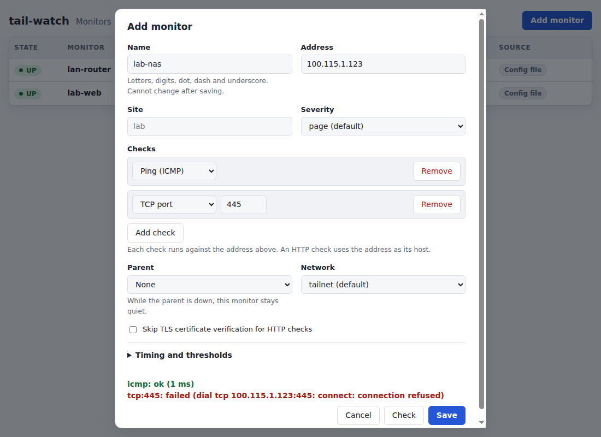
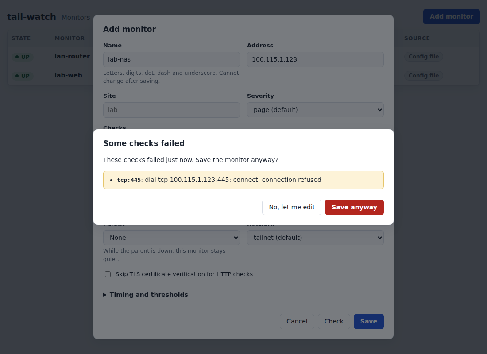
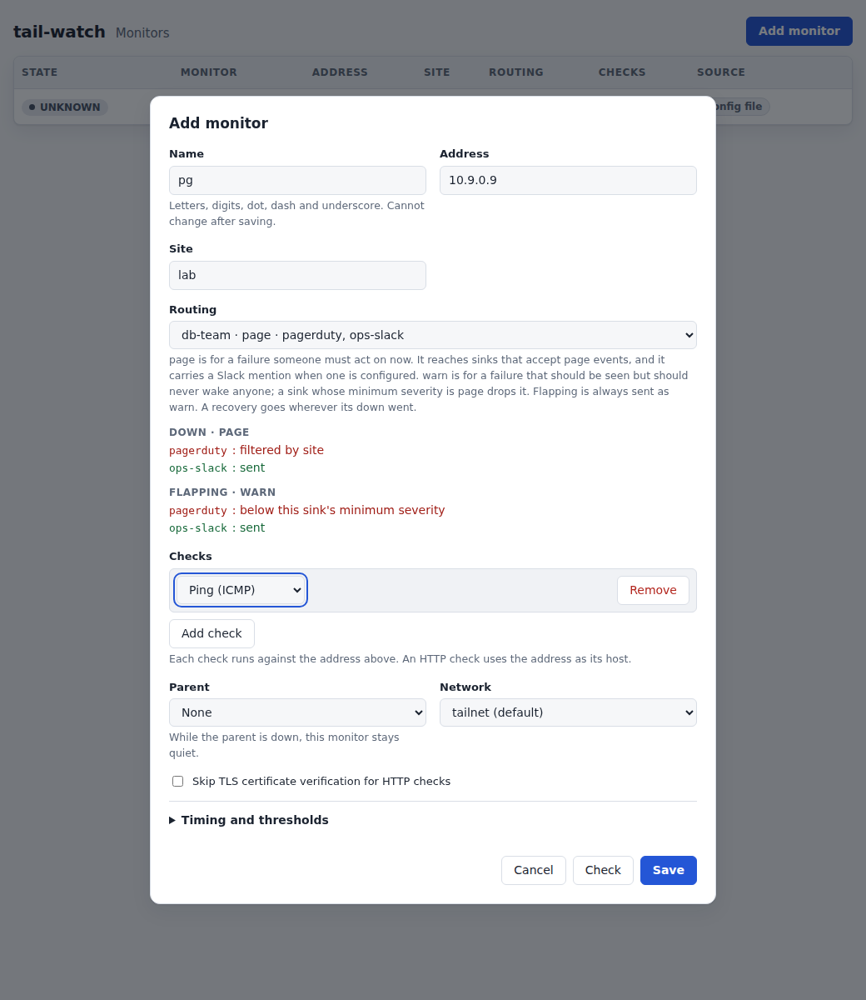
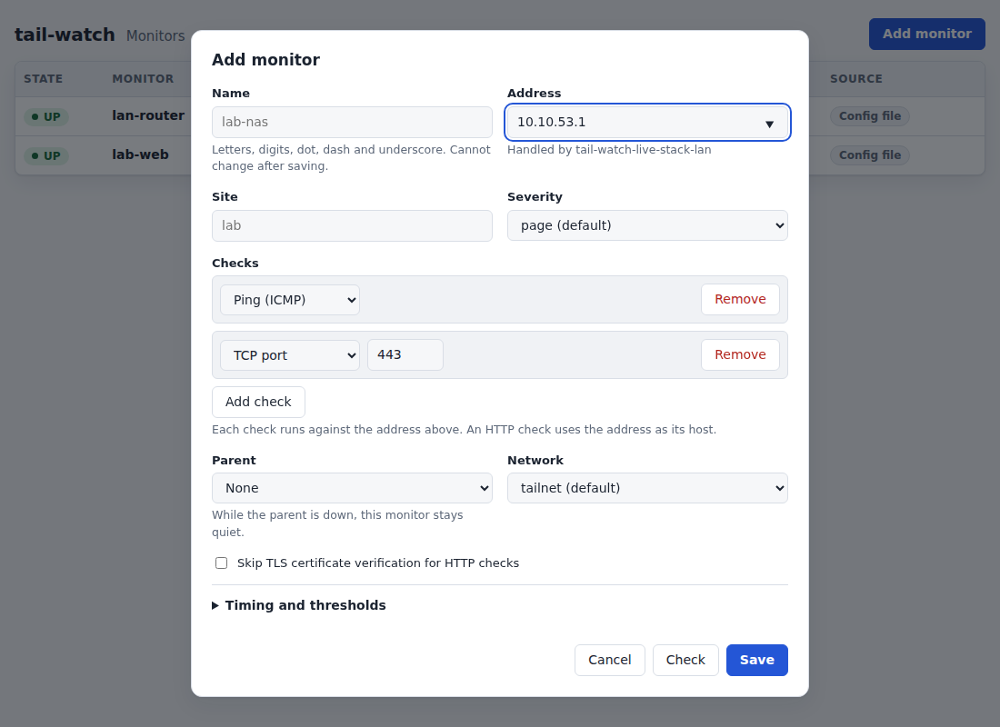

# Manage monitors in the UI

The monitor UI adds, edits and deletes monitors while tail-watch runs, with
no restart and no lost grace timers. It is off by default.

Read [Monitor UI risks](../explanation/monitor-ui-risks.md) first: there is
no login, and whoever can reach the port can make the collector probe any
address it can route to.

## Turn the UI on

Prerequisites: a writable `collector.state_dir`. Monitors created in the UI
are stored in `state_dir/targets.json`. Routes created in the UI are stored
beside it in `state_dir/routes.json`.

Steps:

1. Set `collector.state_dir` in the config:

   ```yaml
   collector:
     listen: 127.0.0.1:9109
     state_dir: /var/lib/tail-watch
     ui: true
   targets:
     - name: nyc-subnet-router
       addr: nyc-router
       checks: [tsping]
   ```

2. Enable the UI with `collector.ui: true` (above) or the flag:

   ```bash
   tail-watch --config /etc/tail-watch/tail-watch.yaml --ui
   ```

   The flag wins over the file, so `--ui=false` turns off a config that
   enables it. Under `--once` the UI is ignored.
3. Restart tail-watch.

Verify: the log has `monitor write API enabled`, and
`http://127.0.0.1:9109/ui/` shows the monitor list. If tail-watch exits with
`the UI needs collector.state_dir to store monitors`, set `state_dir`.

## Reach the UI from another device

The default `listen` address, `127.0.0.1:9109`, is reachable only from the
host. To open the UI from another device on the tailnet, bind an address that
device can reach and grant it access.

Steps:

1. Bind the node's tailnet IP with `--listen` or `collector.listen`, for
   example `--listen 100.101.102.103:9109`. tail-watch then warns
   `monitor write API is reachable beyond loopback; access is controlled only
   by the network`.
2. Grant the device access to the port:

   ```hujson
   {
     "grants": [
       {
         "src": ["autogroup:admin"],
         "dst": ["tag:monitor"],
         "ip": ["tcp:9109"]
       }
     ]
   }
   ```

   A grant covers the whole port, so it also exposes `/metrics`.
3. Open `http://<tailnet-ip>:9109/ui/` from that device.

In the Compose layout tail-watch shares the `tailscale` container's network
namespace, so every process in that namespace can reach a loopback listener.

## Add, edit and delete a monitor

Steps:

1. Click **Add monitor**. Fill in name, address and the other fields. The
   `defaults` block of the YAML file applies to UI monitors. Where an outage
   is sent is covered in
   [Choose where a monitor notifies](#choose-where-a-monitor-notifies).
2. Under **Checks**, click **Add check** once for each check to run. The list
   starts empty, and a monitor needs at least one check. Each row has a type:

   | Type | Fields |
   | --- | --- |
   | Ping (ICMP) | none |
   | Tailscale ping | none |
   | TCP port | the port |
   | HTTP request | scheme, optional port, path, and optional text the body must contain |

   An HTTP check always uses the Address as its host, so there is no host
   field and it follows any change you make to the Address. **Remove** drops a
   row. The rows become the check strings of the [checks reference](../reference/checks.md);
   you never type that syntax. A check in a stored monitor that no row can
   express, for example a hand-edited `targets.json` entry, appears as a
   **Custom** row holding the raw string, and is saved unchanged.
3. Click **Check** to run each check once without saving. The result lists
   every check as `ok` with its latency or `failed` with its error.

   

   Then click **Save**. Errors appear next to the field they belong to, and a
   rejected check is marked on its own row. Saving with no checks is refused
   with a message under the list. Nothing is created until the errors are
   fixed. They come from the same rules the YAML loader uses.

   

   **Save** runs the checks once first. If they all pass, the monitor is saved.
   If any fails, a **Some checks failed** dialog lists each failing check and
   its error. **Save anyway** saves the monitor; a target that is down right
   now is still worth monitoring. **No, let me edit** (or Escape) returns to the
   form with every value kept and the failing rows marked.

   

4. The list shows every monitor. YAML monitors are read-only; only monitors
   created in the UI have **Edit** and **Delete**. Monitors behind a down
   parent show `SUPPRESSED`.

   

5. To delete, click **Delete** and confirm. Deleting a `DOWN` monitor asks
   first, and says its open incident closes.

   

## Choose where a monitor notifies

Create the route in the config file or on the
[Routes page](notification-routes.md).

**Routing** is one field. **All sinks** offers `page` and `warn`, which send
the monitor to every sink. **Routes** lists each route with its severity and
its sink names. A new monitor starts on unrouted `page`. Editing selects the
route or severity already stored. Saving a route sends `route` and no
`severity`. Saving an unrouted choice sends `severity` and no `route`.

If the route list cannot be loaded, `page` and `warn` are still offered and
the monitor can still be saved.

The note under the field says what the two severities mean:

- `page` is a failure someone must act on now. It reaches sinks that accept
  page events, and it carries a Slack mention when one is configured.
- `warn` should be seen and should never wake anyone. A sink whose minimum
  severity is `page` drops it.
- Flapping is always sent as `warn`.
- A recovery goes wherever its down went.

Under the field, the form shows where this monitor's down and flapping notice
would go. It updates as you change routing, site, name or address. Each sink
is sent, dropped with the reason in words ("not in route", "filtered by
site", "below this sink's minimum severity"), or unknown. When every sink
would drop the down, the form warns that this monitor's outage would notify
no one. The warning does not block **Save**. A preview that fails to load
does not block the form either.



The **Routing** column of the list shows the route name and that route's
current severity. A monitor that is not on a route shows its severity and
"all sinks", for example `warn · all sinks`.

## Pick a node from the list

The Address field suggests the tailnet peers the collector can currently see,
read from `GET /api/v1/peers`. Open the form and start typing to filter the
suggestions; each one shows the peer's Tailscale IP, its tags and whether it
is online. Choosing a suggestion fills the Address with the peer's name, or its
first Tailscale IP when it has none, and fills the Name with the same value.
A Name you typed is kept, and choosing another suggestion replaces a Name the
picker filled. Typing an address by hand always works.



Behavior to expect:

- The list means the collector can *see* the peer, not that it is *healthy*:
  a suggested node can still fail the checks you pick.
- Until the first status arrives from `tailscaled`, and whenever the
  connection to it is down, the list is empty. A failed fetch is silent too.
  In both cases type the address as before; nothing blocks saving.
- The Name of an existing monitor never changes when you pick a suggestion
  while editing it.
- When the address is an IP inside a peer's subnet routes, a hint under the
  field names the peer that handles it, so you can pick a monitor of that
  router as the Parent. The Parent select itself is unchanged.

Behavior to expect when editing or deleting:

- An edit is a delete followed by an add. Editing or deleting a `DOWN`
  monitor closes its open incident with `reason: removed`. A new incident
  opens only if the new definition fails `fail_threshold` checks.
- A monitor that other monitors name as `parent` cannot be deleted until
  they are changed. The API answers with `"<name>" is the parent of [...];
  delete or change those first`.
- Editing a parent briefly releases its suppressed dependents, which can page
  while the parent is down.
- A monitor whose name matches a YAML target is skipped at startup with a
  warning, and the YAML target wins.
- `targets.json` uses the YAML field names, is written atomically, and has
  mode 0600.
- `routes.json` uses the YAML route field names, is written atomically, and
  has mode 0600. It is loaded after the config file and before `targets.json`,
  so a monitor can name a route created in the UI. An entry skipped at
  startup stays in the file until a route of the same name is created in the
  UI, which replaces it.
- With the UI off, `targets.json` is left alone and its monitors do not run.
  A startup warning, `dynamic monitors are inactive: the UI is off`, gives
  the count. `routes.json` is not read or modified; if it exists, startup
  logs `routes.json is present but the UI is off; leaving it unread`.

Every monitor write is logged with the caller's address as a `monitor write`
line with `op`, `target`, `status`, `outcome` and `remote`. A probe from
**Check** or **Save** is logged the same way with `op` set to `probe`. A route
write is a `route write` line instead; see [Change a route](#change-a-route).
To find writes, filter the JSON log on that message.

## Read routes and sinks

`GET /api/v1/routes` lists every route from the config file and from
`routes.json`. Each entry has:

- `name`, `severity` (`page` or `warn`) and `sinks` (always a list, in the
  order configured, including a sink the config no longer defines)
- `mention`, only when the route sets one
- `source`, `config` or `ui`
- `readonly`, true when the route comes from the config file
- `used_by`, the monitors that name the route (always a list)
- `missing_sinks`, sink names the route lists that no sink defines (always a
  list, never null)

`GET /api/v1/sinks` lists every configured sink with `name`, `type`, `events`,
`min_severity` and `match` (`sites`, `targets`, `tags`). A Slack sink also has
`mention_on_page` when it is set. The list never includes a URL, a secret, a
header value, or the name of the environment variable or file that holds one.
Sinks are not created, changed or deleted through the API. They stay in the
config file.

Both calls send `Content-Type: application/json` and pass the same Origin
check as a monitor write. They are not authorized and they are not audited.

## Change a route

`POST /api/v1/routes` creates a UI route. `PUT /api/v1/routes/{name}` replaces
one. `DELETE /api/v1/routes/{name}` removes one. The body uses the same fields
as a YAML route: `name`, `severity`, `sinks` and `mention`. The name in a
replace must match the path, or be omitted. To rename a route, delete it and
add a new one.

A route from the config file is refused with 409. Creating a name that already
exists is 409. Deleting a route that any monitor names is 409: the `errors`
text names those monitors and the body also has `used_by`. The route is left
unchanged. Validation problems are 422 with an `errors` list, at `name`,
`severity` or `sinks[n]`. An unknown JSON field, or a body over 64 KiB, is
400. If saving `routes.json` fails, the response is 500 and the running route
table is unchanged.

The file is replaced before the new route takes effect. The next `target.down`
uses it. Replacing a route does not restart monitors and does not close an
open incident. The recovery still goes to the sinks that received the down,
and the down after that uses the new route.

A sink the config no longer defines is not a validation error. The route still
saves, routes to the sinks that remain, and lists the missing name in
`missing_sinks`.

These writes are authorized like a monitor write. Each one, accepted or
refused, is logged at info as `route write` with `op` (`route.create`,
`route.replace` or `route.delete`), `route`, `status`, `outcome` and `remote`.

## Preview where an event would go

`POST /api/v1/route-preview` takes the same JSON body as `POST /api/v1/targets`.
It validates that body the same way as `POST /api/v1/validate`, and returns 422
with the same `errors` when the definition is invalid. It saves nothing and
runs no check.

A valid definition returns 200:

- `severity` is the severity the monitor resolves to
- `route` is the route name, or `""` when the monitor is not on a route
- `recovery` states that a recovery goes to the sinks that received its down
- `down` and `flapping` each have `type`, `severity` and `sinks`

Each sink row has `sink`, `outcome` (`sent`, `dropped` or `unknown`) and,
unless the outcome is `sent`, `reason`. A reason is one of `not_in_route`,
`events`, `min_severity`, `match.sites`, `match.targets`, `match.tags` or
`missing_sink`. A sink the route names that the config no longer defines is an
extra `dropped` row with reason `missing_sink`.

`match.tags` uses the tags of the peer the address resolves to: its MagicDNS
name, its Tailscale IP, or the peer that routes a LAN address. When the peer
view is not ready, or the address matches no peer, that row is `unknown` with
reason `match.tags`. A filter that fails earlier, such as site or severity,
still decides.

The preview calls the same routing functions delivery uses. It requires JSON
and the same Origin check as a monitor write. It is not authorized and it is
not audited.
