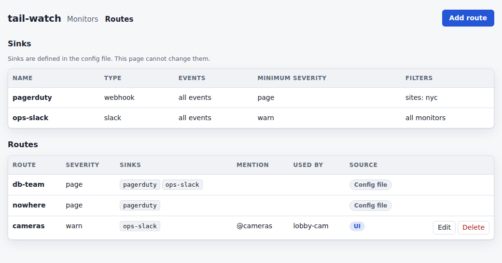

# Route notifications

A route sends one monitor's down and flapping notices to a named set of sinks,
at one severity. A monitor with no route is a candidate for every sink, at its
own severity. The default is `page`.

The keys are in the `routes` section of
[Configuration](../reference/config.md). This page is how to choose a severity
and attach a monitor.

## Choose page or warn

`page` is a failure someone must act on now. It reaches sinks whose minimum
severity is `page`, and a Slack sink includes a mention when the route or the
sink sets one. The route's mention replaces the sink's `mention_on_page` for
that down.

`warn` should be seen and should never wake anyone. A sink whose minimum
severity is `page` drops it.

A route only chooses the candidate sinks. Each sink still applies its own
minimum severity and `match`.

Two rules hold whether or not the monitor is on a route:

- Flapping is always sent as `warn`, with no mention.
- A recovery goes to the sinks that received its down. Editing the route
  later does not change where that recovery goes.

`collector.started` and a test notification ignore routes.

## Define a route in the config file

Name the sinks in `sinks`, then name the route. `check-config` prints where
each target's down would go. It does not need the `*_env` secrets to be set.

```yaml
collector:
  state_dir: /var/lib/tail-watch
sinks:
  - name: ops-slack
    type: slack
    url_env: SLACK_WEBHOOK_URL
    min_severity: warn
  - name: pagerduty
    type: webhook
    url_env: PAGERDUTY_URL
    min_severity: page
    match:
      sites: [nyc]
routes:
  - name: db-team
    severity: page
    sinks: [pagerduty, ops-slack]
    mention: "<!subteam^S0DB>"
  - name: cameras
    severity: warn
    sinks: [ops-slack]
targets:
  - name: pg-primary
    addr: 10.0.0.1
    site: nyc
    checks: [icmp]
    route: db-team
  - name: lobby-cam
    addr: 10.0.0.2
    checks: [icmp]
    severity: warn
```

```bash
tail-watch check-config --config tail-watch.yaml
```

`check-config` lists `pg-primary` on `db-team` with those two sinks, and
`lobby-cam` with no route and every sink. `lobby-cam` is `warn`, so when an
event is delivered `pagerduty` still drops it. The preview shows that.

A route in this file is read-only in the UI. Change it here and restart.
Every name in a route's `sinks` list has to be a sink in this file. An unknown
name is a config error.

A local-only collector has no UI. Routes in the file still apply.

## Define a route in the UI

Turn the UI on first. See [Manage monitors in the UI](monitor-ui.md).

1. Open the monitor list and click **Routes**, or open `/ui/#routes`.
2. Read the sink table. It shows each sink's name, type, events, minimum
   severity and filters. A sink that accepts every event says `all events`.
   Sinks are defined in the config file. This page cannot change them, and it
   never shows a URL or a secret.
3. Click **Add route**. Set the name, the severity and the mention, and check
   the sinks that should hear monitors on this route.
4. Click **Save**. The route is marked **UI** and appears in the monitor
   form's routing field. The name cannot be changed afterward; delete the
   route and add it again to rename it.



A route from the config file is marked **Config file** and has no **Edit** or
**Delete**.

To delete a UI route, click **Delete** and confirm. If a monitor still uses
it, the dialog names that monitor and the route stays. Change or delete those
monitors first.

A sink the config no longer defines stays listed on the route and is marked
missing.

## Move a monitor onto a route

1. On **Monitors**, edit the monitor, or add one.
2. Under **Routing**, choose the route. Each option shows the route's
   severity and its sinks. **All sinks** leaves the monitor unrouted, at
   `page` or `warn`.
3. Click **Save**. A routed monitor is stored with `route` and no `severity`.
   An unrouted monitor is stored with `severity` and no `route`.

The **Routing** column shows the route name and that route's current
severity. A monitor that is not on a route shows its severity alone.

## Check the preview

Once the name and address are filled in, the form shows where this monitor's
down and flapping notice would go. It updates when the route, site, name or
address changes. Each sink is sent, dropped or unknown.

When every sink would drop the down, the form says that this monitor's outage
would notify no one. Saving is still possible. A preview that fails to load
does not block **Save** either.

The wording of each reason is in
[Choose where a monitor notifies](monitor-ui.md#choose-where-a-monitor-notifies).
